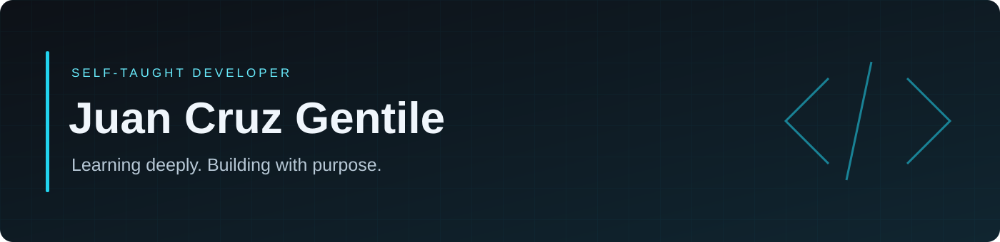

  

# Hi, I'm Juan Cruz

**Self-taught developer · Building projects and strengthening my foundations**

I enjoy turning ideas into working software. I learn through hands-on projects, persistence, and a willingness to revisit what I don't yet understand.

I use AI-assisted development to explore ideas and build projects. I'm still early in my journey, and my focus is to better understand the code I work with, strengthen my programming fundamentals, and gain practical experience.

I'm looking for opportunities to contribute to well-defined tasks, learn from feedback, and grow alongside a team.

## Selected projects

### [N.E.O.-type](https://github.com/juancruzgentile/N.E.O.-type)

A typing practice application for programmers, built with AI assistance. It brings together code-based exercises, adaptive progression, and practice statistics in an offline experience.

**Technologies used in the project:** React, TypeScript, Vite.

[Explore the project →](https://github.com/juancruzgentile/N.E.O.-type)

### [Cerberus](https://github.com/juancruzgentile/Cerberus)

A project built with AI assistance to explore event ingestion, alert delivery, and full-text search across cooperating services.

**Technologies used in the project:** C, Go, Rust, SQLite.

[Explore the project →](https://github.com/juancruzgentile/Cerberus)

## How I approach learning

- Build something concrete, then study the concepts behind it.
- Break unfamiliar problems into smaller steps.
- Ask questions and use feedback to improve.
- Keep working through obstacles and revisit assumptions when needed.

## Current focus

Programming fundamentals, debugging, testing, and understanding how application components fit together.

## Opportunities

Interested in junior roles and small, clearly scoped development tasks where I can contribute honestly and keep learning.

You can see my work and follow my progress in the repositories below.
